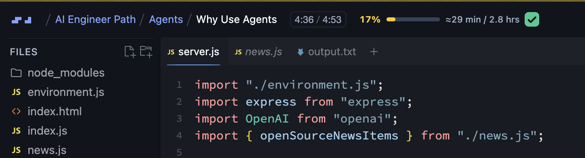
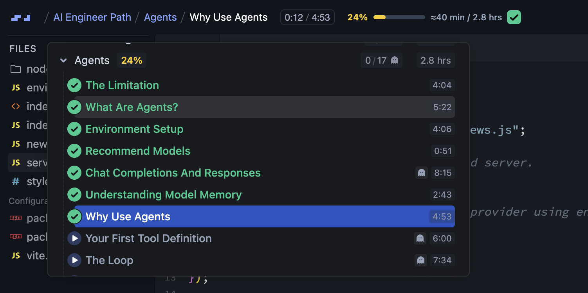

<p align="center">
  
</p>

<h1 align="center">Scrimba Section Progress</h1>

<p align="center">
  See how far you have come in a section without leaving the lesson.
  <br>
  <strong>Completion percentage · Progress bar · Estimated watched time</strong>
</p>



> **Unofficial project.** This extension is not made by or affiliated with Scrimba.

The badge sits beside the lesson timer. It uses Scrimba's completion percentage for the current lesson's immediate parent section and estimates watched time from the section duration. Plain JavaScript and CSS; no framework, analytics, account, or extension-initiated network requests.

### Where the number comes from



## Install

1. Clone or download this repository.
2. Open `arc://extensions` in Arc, or `chrome://extensions` in Chrome.
3. Turn on **Developer mode**.
4. Select **Load unpacked** and choose the folder containing `manifest.json`.
5. Open or refresh a Scrimba lesson.

When you change the extension files, click **Reload** on the browser's extensions page, then refresh the lesson.

## Build a ZIP

Run `sh build.sh` to package the extension into the ignored `build/` folder. The ZIP filename follows the version in `manifest.json`.

## What the numbers mean

```text
0:30 / 2:40    42%  ━━━━━───────  ≈53 min / 2.1 hrs
lesson timer   section complete     estimated time / section duration
```

- **42%** comes from Scrimba's progress value for the current lesson's immediate parent section.
- **2.1 hrs** is the section duration displayed by Scrimba.
- **≈53 min** is `42% × 2.1 hours`, rounded to minutes. It is an estimate because Scrimba rounds the displayed duration and the extension does not track your watch time.

When Scrimba exposes a reliable open/closed state, the extension briefly opens the lesson outline to read section data and closes only the panel it opened. It leaves an already-open outline alone and stops controlling it when you interact or navigate. A failed read gets one delayed retry. If the panel state cannot be determined, open the lesson outline manually to populate the badge. On narrow screens it hides the time summary while retaining the percentage and bar.

## Scope and privacy

- Loads on `https://scrimba.com/*` and shows a badge only when lesson data is available.
- Processes the current lesson URL and section outline locally in memory; it does not transmit them or save them to persistent storage.
- Requests no additional extension API permissions.
- Shows no badge if Scrimba does not expose the section data. A change to Scrimba's page markup may require updating the selectors.

## Project files

```text
manifest.json       Manifest V3 configuration
progress.js         Reads section progress and injects the badge
progress.css        Badge styling
build.sh            Packages the extension into build/
icons/              Extension icon in browser-required sizes
assets/             README screenshots
```

The extension icon is original artwork, as confirmed by the project owner.

## Privacy policy and store assets

See [Privacy Policy](PRIVACY.md) for data handling details. Before submission, publish it at a publicly accessible URL and enter that URL in the Chrome Web Store dashboard. Store listing assets and submission notes are in `store/`.

## Checks

Run `node --test tests/progress.test.cjs` and `sh build.sh`. Live authenticated Scrimba testing is still required before release.
